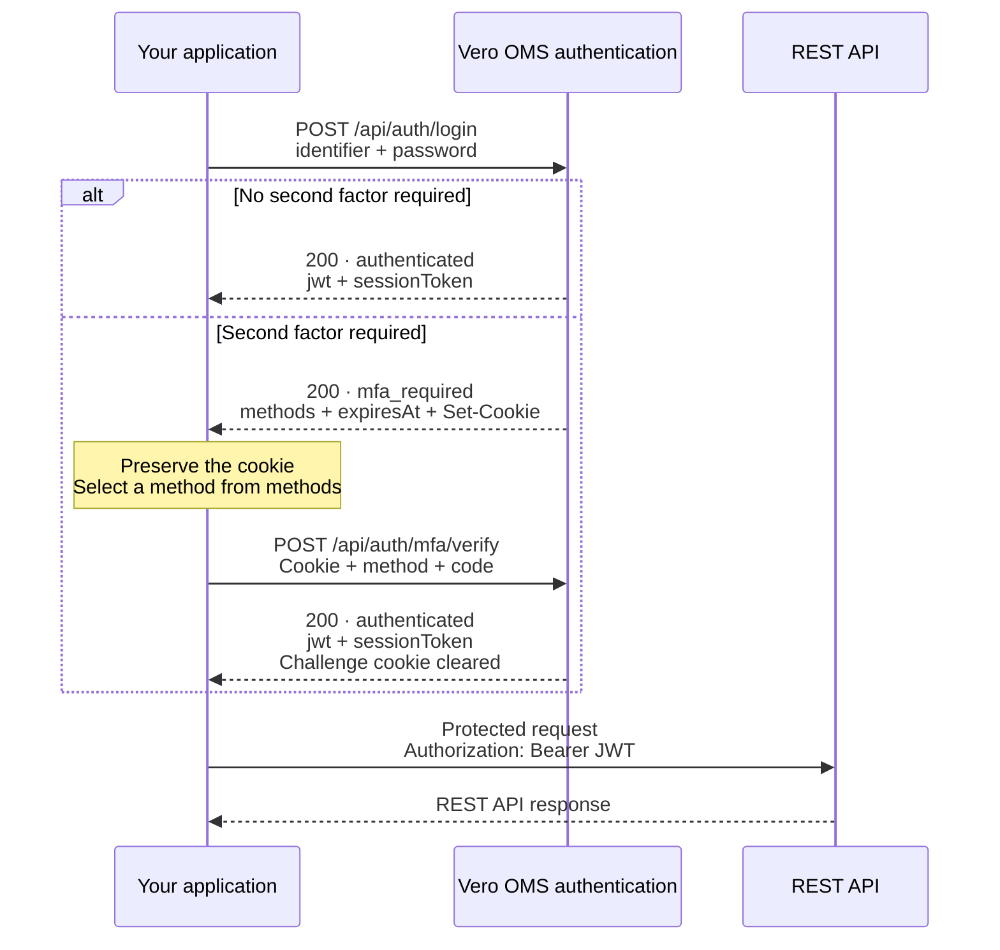

Send authentication requests to `https://platform.verolabs.co`. Use the resulting JWT for protected REST API requests to `https://api-oms.verolabs.co`.

## Login flow

If your account requires two-factor authentication (MFA), verify the second factor before using the REST API.



The MFA branch shows successful verification. If verification fails, follow [error handling](/en/apis/rest/auth/post-api-auth-mfa-verify#error-handling) before continuing.

## Response states

Both states below use HTTP `200`. Check `status` before reading `jwt`.

| `status` | Meaning | Next action |
| --- | --- | --- |
| `authenticated` | Authentication is complete. The response includes `jwt` and `sessionToken`. | Use `jwt` for REST API requests. |
| `mfa_required` | A second factor is required. The response includes `methods` and `expiresAt`, without `jwt` or `sessionToken`. | Preserve the cookie and [verify a second factor](/en/apis/rest/auth/post-api-auth-mfa-verify). |

## Log in with cURL

Run these Bash examples in the same shell with `curl` and `jq`. Preserve cookies through login and verification. Browser requests must use the `https://platform.verolabs.co` origin.

### 1. Submit the email and password

```bash
AUTH_BASE_URL="https://platform.verolabs.co"
COOKIE_JAR="$(mktemp)"
chmod 600 "$COOKIE_JAR"
read -r -p "Account email: " IDENTIFIER
read -r -s -p "Password: " PASSWORD
printf '\n'

AUTH_RESPONSE="$(curl --silent --show-error --fail-with-body \
  --request POST "$AUTH_BASE_URL/api/auth/login" \
  --cookie-jar "$COOKIE_JAR" \
  --header 'Content-Type: application/json' \
  --data "$(jq -n --arg identifier "$IDENTIFIER" --arg password "$PASSWORD" \
    '{identifier: $identifier, password: $password}')")"
unset PASSWORD

printf '%s\n' "$AUTH_RESPONSE" | jq '{status, methods, expiresAt}'
```

If `status` is `authenticated`, proceed to step 3. If it is `mfa_required`, complete step 2 before extracting the JWT.

### 2. Verify the second factor when required

For `totp`, read the current six-digit code from your authenticator app. Keep it as a string to preserve leading zeros.

```bash
MFA_METHOD="totp"
read -r -s -p "Authenticator code: " MFA_CODE
printf '\n'

AUTH_RESPONSE="$(curl --silent --show-error --fail-with-body \
  --request POST "$AUTH_BASE_URL/api/auth/mfa/verify" \
  --cookie "$COOKIE_JAR" \
  --cookie-jar "$COOKIE_JAR" \
  --header 'Content-Type: application/json' \
  --data "$(jq -n --arg method "$MFA_METHOD" --arg code "$MFA_CODE" \
    '{method: $method, code: $code}')")"
unset MFA_CODE

printf '%s\n' "$AUTH_RESPONSE" | jq '{status, aal: .session.authenticator_assurance_level}'
```

Use a method listed in `methods`. For a backup code, set `MFA_METHOD="lookup_secret"` and enter an unused code. Each backup code can be used once.

Successful verification returns `status: "authenticated"` and a JWT. The API clears the challenge cookie.

### 3. Call the REST API with the JWT

```bash
JWT="$(printf '%s\n' "$AUTH_RESPONSE" \
  | jq -er 'select(.status == "authenticated") | .jwt')"

curl --silent --show-error --fail-with-body \
  --header "Authorization: Bearer $JWT" \
  'https://api-oms.verolabs.co/api/v1/oms/risk/accounts'

rm -- "$COOKIE_JAR"
unset AUTH_RESPONSE JWT
```

Use `jwt` for REST API authorization and `sessionToken` to [resume a session](/en/apis/rest/auth/post-api-auth-mfa-resume). Keep both tokens confidential.

## Retry and expiration

An incorrect code returns an error without a JWT. Retry while the challenge is valid. HTTP `410` requires a new login and cookie. Do not modify the challenge cookie or reuse a backup code.
