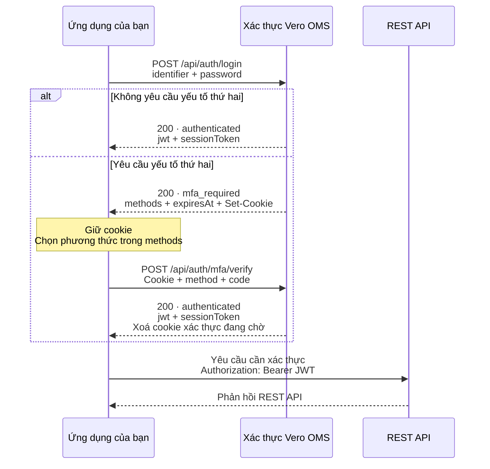

Gửi yêu cầu xác thực đến `https://platform.verolabs.co`. Dùng JWT nhận được để gọi REST API cần xác thực tại `https://api-oms.verolabs.co`.

## Luồng đăng nhập

Nếu tài khoản yêu cầu xác thực hai lớp (MFA), hoàn tất xác minh yếu tố thứ hai trước khi gọi REST API.



Nhánh MFA minh họa trường hợp xác minh thành công. Nếu xác minh thất bại, thực hiện bước [xử lý lỗi](/vi/apis/rest/auth/post-api-auth-mfa-verify#xử-lý-lỗi) trước khi tiếp tục.

## Trạng thái phản hồi

Cả hai trạng thái dưới đây đều trả HTTP `200`. Kiểm tra `status` trước khi đọc `jwt`.

| `status` | Ý nghĩa | Bước tiếp theo |
| --- | --- | --- |
| `authenticated` | Xác thực hoàn tất. Phản hồi chứa `jwt` và `sessionToken`. | Dùng `jwt` để gọi REST API. |
| `mfa_required` | Cần yếu tố xác thực thứ hai. Phản hồi chứa `methods` và `expiresAt`, không chứa `jwt` hoặc `sessionToken`. | Giữ cookie và [xác minh yếu tố thứ hai](/vi/apis/rest/auth/post-api-auth-mfa-verify). |

## Đăng nhập bằng cURL

Chạy các ví dụ Bash trong cùng phiên lệnh với `curl` và `jq`. Giữ cookie qua bước đăng nhập và xác minh. Yêu cầu từ trình duyệt phải có origin là `https://platform.verolabs.co`.

### 1. Gửi email và mật khẩu

```bash
AUTH_BASE_URL="https://platform.verolabs.co"
COOKIE_JAR="$(mktemp)"
chmod 600 "$COOKIE_JAR"
read -r -p "Email tài khoản: " IDENTIFIER
read -r -s -p "Mật khẩu: " PASSWORD
printf '\n'

AUTH_RESPONSE="$(curl --silent --show-error --fail-with-body \
  --request POST "$AUTH_BASE_URL/api/auth/login" \
  --cookie-jar "$COOKIE_JAR" \
  --header 'Content-Type: application/json' \
  --data "$(jq -n --arg identifier "$IDENTIFIER" --arg password "$PASSWORD" \
    '{identifier: $identifier, password: $password}')")"
unset PASSWORD

printf '%s\n' "$AUTH_RESPONSE" | jq '{status, methods, expiresAt}'
```

Nếu `status` là `authenticated`, chuyển đến bước 3. Nếu là `mfa_required`, hoàn tất bước 2 trước khi lấy JWT.

### 2. Xác minh yếu tố thứ hai khi được yêu cầu

Với `totp`, nhập mã 6 chữ số hiện tại trong ứng dụng xác thực. Giữ mã dưới dạng chuỗi để không mất số 0 ở đầu.

```bash
MFA_METHOD="totp"
read -r -s -p "Mã trong ứng dụng xác thực: " MFA_CODE
printf '\n'

AUTH_RESPONSE="$(curl --silent --show-error --fail-with-body \
  --request POST "$AUTH_BASE_URL/api/auth/mfa/verify" \
  --cookie "$COOKIE_JAR" \
  --cookie-jar "$COOKIE_JAR" \
  --header 'Content-Type: application/json' \
  --data "$(jq -n --arg method "$MFA_METHOD" --arg code "$MFA_CODE" \
    '{method: $method, code: $code}')")"
unset MFA_CODE

printf '%s\n' "$AUTH_RESPONSE" | jq '{status, aal: .session.authenticator_assurance_level}'
```

Chọn phương thức có trong `methods`. Với mã dự phòng, đặt `MFA_METHOD="lookup_secret"` và nhập mã chưa sử dụng. Mỗi mã dự phòng chỉ dùng được một lần.

Xác minh thành công trả `status: "authenticated"` và JWT. API xoá cookie xác thực đang chờ.

### 3. Gọi REST API bằng JWT

```bash
JWT="$(printf '%s\n' "$AUTH_RESPONSE" \
  | jq -er 'select(.status == "authenticated") | .jwt')"

curl --silent --show-error --fail-with-body \
  --header "Authorization: Bearer $JWT" \
  'https://api-oms.verolabs.co/api/v1/oms/risk/accounts'

rm -- "$COOKIE_JAR"
unset AUTH_RESPONSE JWT
```

Dùng `jwt` để cấp quyền truy cập REST API và `sessionToken` để [tiếp tục phiên](/vi/apis/rest/auth/post-api-auth-mfa-resume). Giữ bí mật cả hai token.

## Thử lại và hết hạn

Mã sai trả lỗi và không cấp JWT. Thử lại khi yêu cầu xác thực còn hiệu lực. HTTP `410` yêu cầu đăng nhập lại để nhận cookie mới. Không sửa cookie xác thực hoặc dùng lại mã dự phòng.
